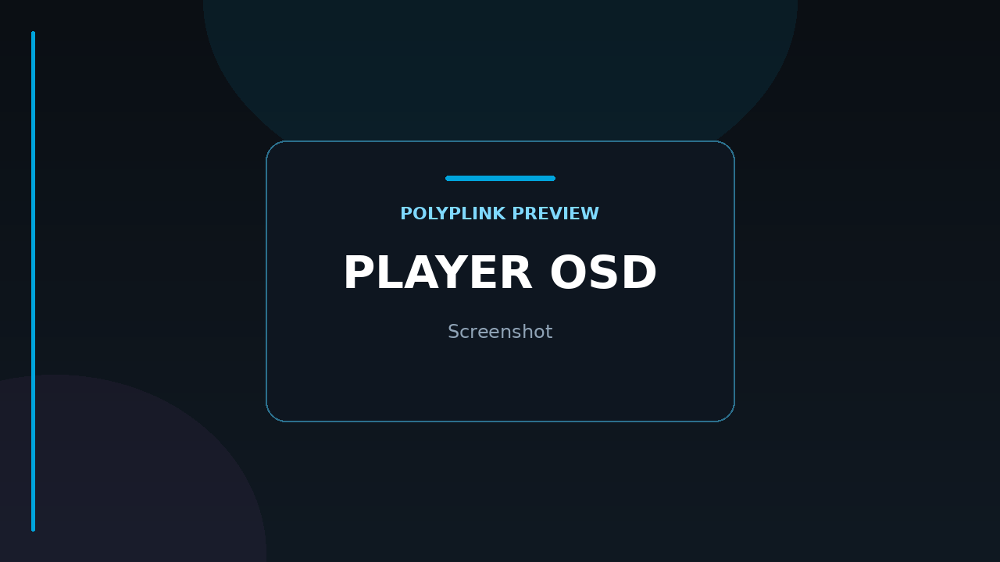

# PolypLink

> English: [README.md](README.md)

[](https://github.com/AndreaCaproni/PolypLink/actions/workflows/check.yml)
[](https://github.com/AndreaCaproni/PolypLink/releases)
[](LICENSE)


**Client Jellyfin nativo per Valve Steam Link (2015).**
Niente Chromium, niente Electron, niente browser: un'app Qt Quick/C++ che parla
direttamente con il decoder hardware del Link.

> **Stato: beta 0.3.0** — già usabile per guardare film e serie, ancora in
> rifinitura. Progetto indipendente, non affiliato al progetto Jellyfin.

## Screenshot

| Home | Dettaglio |
|:---:|:---:|
|  |  |
| **Player OSD** | **Impostazioni** |
|  |  |

---

## Perché esiste

I client ufficiali (Jellyfin Media Player, Jellyfin Web) sono **jellyfin-web
dentro Chromium**. Sul Link — single-core, 256 MB di RAM — non partono.

PolypLink usa l'SDK Valve e le API `SLVideo`/`SLAudio` del firmware per
decodificare H.264 in hardware e riprodurre l'audio AAC. Il server fa il lavoro
pesante: chiediamo **sempre** una transcodifica H.264 + AAC in HLS, così il box
non deve saper leggere MKV, HEVC, 4K o HDR.

---

## Cosa sa fare

- **Home** con *Continua a guardare*, *Prossimo episodio*, *Aggiunti di
  recente* (con la libreria di provenienza) e le librerie.
- **Libreria completa**: film, serie, stagioni, episodi; scheda con trama,
  anno, durata, voto, visto/preferito.
- **Serie e stagioni**: *Riproduci* (prossimo episodio), *Stagioni*,
  visto/preferito; pagina stagione con pulsanti, trama ed elenco episodi.
- **Ripresa**: *Riprendi* e *Riproduci dall'inizio*, posizione sincronizzata
  col server.
- **Player** con OSD navigabile: barra di seek con cursore e anteprima del
  tempo, passo accelerato fino a 3 minuti, pausa, -10/+30 secondi, traccia
  audio, sottotitoli, qualità con menu dedicati, statistiche, cartello
  connessione persa e scheda prossimo episodio.
- **Accesso**: ricerca automatica del server (UDP Jellyfin + scansione della
  LAN), indirizzo manuale, utente/password con tastiera a schermo, Quick
  Connect.
- **Preferiti** come scheda nella barra superiore.
- **Errori di rete chiari**: timeout, *server non raggiungibile* con **A** per
  riprovare, *connessione persa* durante la riproduzione.
- **Account** e **Impostazioni**: pagine presenti; le voci sono segnaposto per
  la versione stabile.

---

## Roadmap

- Righe della home: mostra/nascondi e riordina.
- Ricerca tra film, serie ed episodi.
- Autoplay del prossimo episodio con countdown.
- Trickplay: miniature sulla barra di seek.
- Seek in-stream senza riavviare la transcodifica.
- Revisione madrelingua delle 21 lingue.

---

## Requisiti

- Valve **Steam Link** (hardware 2015) con firmware aggiornato.
- Un server **Jellyfin** raggiungibile in rete locale (testato con Jellyfin
  12.4).
- **La transcodifica DEVE essere abilitata sul server Jellyfin.** PolypLink
  chiede sempre una transcodifica H.264 + AAC in HLS e non usa il direct play;
  senza transcodifica lato server i video non partono.
- Una **chiavetta USB** per l'installazione.
- Per compilare: **Steam Link SDK** (Qt 5.14.1 + toolchain ARM), non incluso
  nel repository.

---

## Installazione

La guida passo-passo è in **[docs/INSTALL.md](docs/INSTALL.md)**.
In breve: copia la cartella `steamlink/` nella radice della chiavetta, inserisci
la chiavetta con il Link spento e accendilo. Dopo 1–2 minuti l'app compare
nella home.

Il pacchetto si crea con:

```bash
./build.sh                        # compila e prepara dist/steamlink/
./build.sh --install /media/USB   # compila e copia direttamente sulla chiavetta
```

Asset di release (zip USB, tgz e `SHA256SUMS`):

```bash
./scripts/package-release.sh
```

---

## Comandi

Elenco completo in **[docs/CONTROLS.md](docs/CONTROLS.md)**. In sintesi:

| Dove | Comando |
|---|---|
| Home | frecce per muoversi, **A** apre, **B** indietro, **su** dalla prima riga va alla barra superiore |
| Barra superiore | sinistra/destra scelgono Home/Preferiti/Account/Impostazioni, **A** apre, **giù** torna al contenuto |
| Player | **A** conferma/seleziona, **sinistra/destra** spostano il cursore, **su** nasconde l'OSD, **giù** va ai pulsanti, **B** nasconde/esce, **Start** statistiche |

---

## Come funziona

```
Server Jellyfin                       Steam Link
───────────────                       ──────────
mkv / hevc / 4k  ──►  ffmpeg  ──►  HLS (H.264 + AAC)  ──►  demux TS
                                                          ├─► SLVideo (H.264 HW)
                                                          └─► AAC → SLAudio
```

- Il client costruisce una `DeviceProfile` che obbliga H.264/AAC in HLS e
  disattiva il copia-incolla dei flussi (`AllowVideoStreamCopy=false`).
- Il player scarica i segmenti del playlist, ricostruisce gli access unit
  H.264 dai NAL, li passa a `SLVideo`, decodifica l'AAC con una build minima di
  FFmpeg e sincronizza l'audio con `SLAudio`.
- La posizione di seek non si chiede con `StartTimeTicks`: il player parte dal
  segmento HLS che copre quel tempo e il server riavvia la transcodifica lì.

Dettagli e scelte tecniche: **[docs/ARCHITETTURA.md](docs/ARCHITETTURA.md)**.

---

## Compilare

Serve lo **Steam Link SDK** di Valve (non incluso). Di default il build lo
cerca in `../steamlink-sdk`, oppure:

```bash
./build.sh --sdk ~/steamlink-sdk
```

Requisiti: `make`, `qmake` dall'SDK, toolchain ARM dell'SDK.

Le librerie FFmpeg per l'AAC sono già incluse in `third_party/ffmpeg/`; la
ricetta per ricompilarle è in **[docs/FFMPEG.md](docs/FFMPEG.md)**.

Controllo rapido di QML e script:

```bash
./scripts/check.sh
```

---

## Struttura del progetto

```
src/            C++: controller UI, client API, player HLS, demux TS
qml/            interfaccia Qt Quick (1280x720 virtuale, scalata)
deploy/         launcher e hook di boot per la chiavetta
packaging/      icona dell'app
third_party/    FFmpeg minimale (solo AAC) + licenza LGPL
docs/           installazione, comandi, architettura, ffmpeg
build.sh        build + pacchetto USB
```

---

## Limiti noti della beta

- **Seek e cambio impostazioni riavviano il flusso** (~2 secondi): il passo
  successivo è farlo dentro il player.
- **Sottotitoli solo in burn-in** (incisi dal server), nessun sottotitolo
  esterno o stilizzato.
- **Niente ricerca**, niente coda di riproduzione, niente autoplay del
  prossimo episodio, niente miniature trickplay sulla barra.
- Paginazione libreria limitata a 300 elementi per vista.
- Solo **H.264 8-bit**: niente HEVC, HDR, AV1; il Link decodifica solo quello.
- **La qualità arriva fino a 100 Mbps** come esperimento. Il Link ha Ethernet
  100 Mbit, quindi 80–100 Mbps possono saturare il collegamento; sopra ~40 Mbps
  il guadagno visivo è minimo e gli scatti diventano probabili.
- Avviando un episodio dalla pagina serie/stagione il pannello **Audio** usa la
  traccia predefinita del server; le tracce dell'episodio si caricano
  aprendone la scheda.
- La ricerca automatica del server copre la **/24 locale**; server su altre
  VLAN si inseriscono a mano.
- **Interfaccia in 21 lingue**: italiano, inglese, spagnolo, francese, tedesco,
  portoghese (Brasile e Portogallo), russo, olandese, polacco, svedese, danese,
  norvegese bokmål, ceco, ucraino, catalano, turco, rumeno, greco, ungherese e
  finlandese. La lingua si cambia dalle Impostazioni e resta memorizzata tra un
  avvio e l'altro; al primo avvio segue la lingua di sistema, con l'inglese come
  fallback. Le traduzioni sono un primo passaggio, non revisionate da
  madrelingua.
- **Titoli, trame e generi seguono la lingua dei metadati del server**, impostata
  per libreria in Jellyfin. La lingua dell'interfaccia non traduce i metadati.

---

## Note di sviluppo

Costruito con un forte supporto AI, poi testato e curato su hardware Steam Link
reale. È una beta: aspettati qualche spigolo e allega log e dettagli hardware
nelle segnalazioni.

## Contribuire

Questo è il repository canonico. Bug report e pull request sono benvenuti qui:
meglio mandare i miglioramenti upstream che pubblicare fork vibecoded separati.

---

## Licenza

Codice: **MIT**, vedi [LICENSE](LICENSE).

Componenti di terze parti: [THIRD_PARTY.md](THIRD_PARTY.md)
(FFmpeg LGPL 2.1+, SDK Valve, Qt).

I pacchetti di release includono una cartella `licenses/` con licenza MIT,
testo LGPL di FFmpeg e note di terze parti.

Jellyfin: <https://jellyfin.org>. PolypLink è un progetto indipendente, non
affiliato al progetto Jellyfin.
