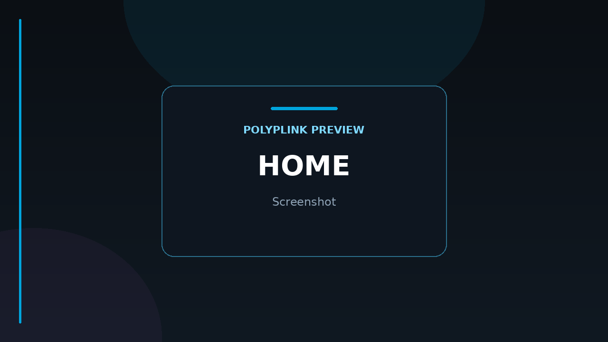
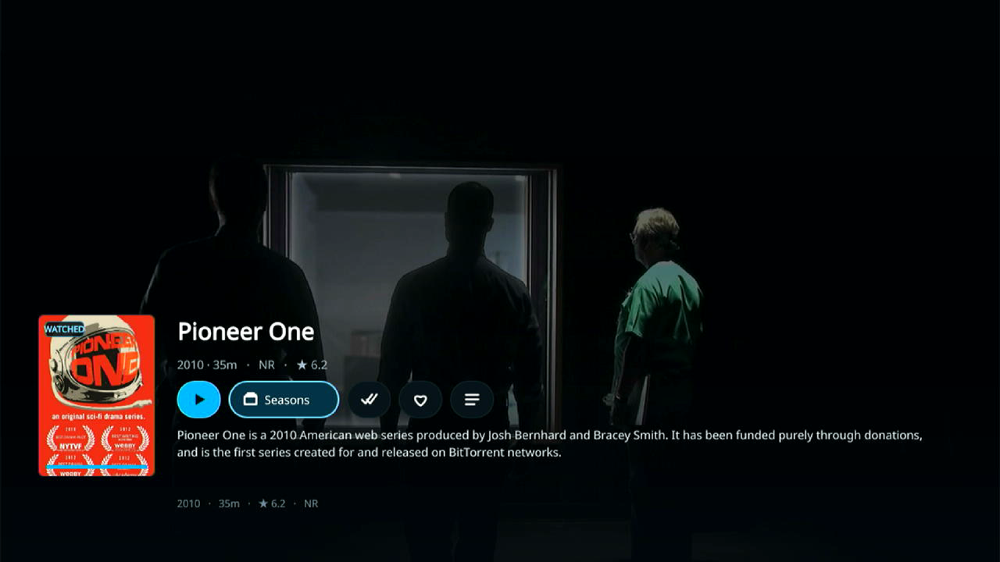
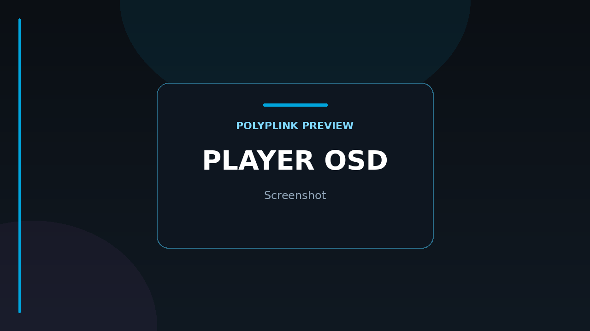
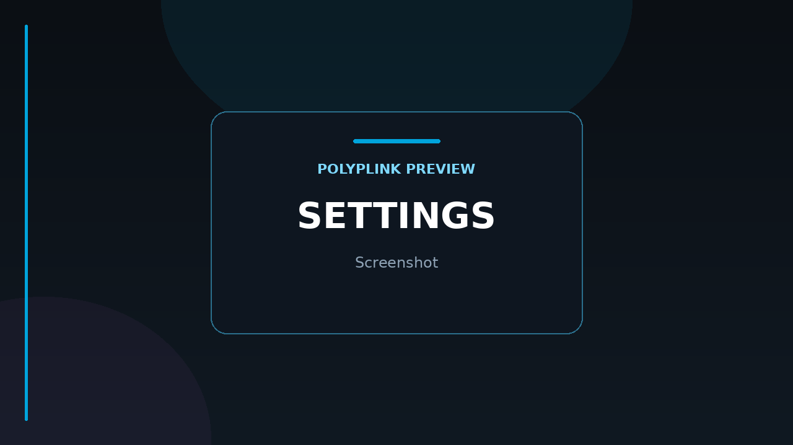

# PolypLink

> Italiano: [README.it.md](README.it.md)

[](https://github.com/AndreaCaproni/PolypLink/actions/workflows/check.yml)
[](https://github.com/AndreaCaproni/PolypLink/releases)
[](LICENSE)


**A native Jellyfin client for the Valve Steam Link (2015).**
No Chromium, no Electron, no browser: a Qt Quick/C++ app that talks directly to
the Link's hardware decoder.

> **Status: beta 0.4.2** — already usable for movies and TV shows, still being
> polished. Independent project, not affiliated with the Jellyfin project.

## Screenshots

| Home | Detail |
|:---:|:---:|
|  |  |
| **Player OSD** | **Settings** |
|  |  |

[More screenshots](docs/SCREENSHOTS.md)

---

## Why it exists

The official clients (Jellyfin Media Player, Jellyfin Web) are **jellyfin-web
inside Chromium**. On the Link — single-core CPU, 256 MB of RAM — they don't
start.

PolypLink uses the Valve SDK and the firmware's `SLVideo`/`SLAudio` APIs to
decode H.264 in hardware and play AAC audio. The server does the heavy lifting:
we **always** ask for an H.264 + AAC HLS transcode, so the box never has to
understand MKV, HEVC, 4K or HDR.

---

## Features

- **Home** with *Continue watching*, *Next up*, *Recently added* (with the
  source library) and your libraries.
- **Full library browsing**: movies, series, seasons, episodes; detail page
  with overview, year, runtime, rating, watched/favorite.
- **Series and seasons**: *Play* (next episode), *Seasons*, watched/favorite;
  the season page has buttons, the overview and the episode list.
- **Resume**: *Resume* and *Play from beginning*, position synced with the
  server.
- **Player** with a navigable OSD: seek bar with cursor and time preview,
  acceleration up to 3 minutes, pause, -10/+30 seconds, audio track, subtitles,
  quality with dedicated dropdown menus, an audio-delay offset, stats, a
  connection-lost card and a next-episode card.
- **Sign in**: automatic server discovery (Jellyfin UDP + LAN scan), manual
  address, username/password with the on-screen keyboard, Quick Connect.
- **Favorites** as a tab in the top bar.
- **Clear network errors**: timeouts, *server unreachable* with **A** to retry,
  *connection lost* during playback.
- **Account** and **Settings**: account stats plus real settings for default
  quality, OSD duration and audio delay; the remaining entries are placeholders
  for the stable release.

---

## Roadmap

- Home rows: show/hide and reorder.
- Search across movies, series and episodes.
- Next-episode autoplay with countdown.
- Trickplay thumbnails on the seek bar.
- In-stream seeking without restarting the transcode.
- More native-speaker review for the 21 UI languages.

---

## Requirements

- Valve **Steam Link** (2015 hardware) with updated firmware.
- A **Jellyfin** server reachable on your LAN (tested with Jellyfin 12.4).
- **Transcoding MUST be enabled on the Jellyfin server.** PolypLink always asks
  for an H.264 + AAC HLS transcode and does not direct-play; without server
  transcoding, videos will not start.
- A **USB drive** for installation.
- To build: **Steam Link SDK** (Qt 5.14.1 + ARM toolchain), not included in
  this repository.

---

## Security

- **HTTPS is recommended.** The client verifies TLS certificates and rejects
  self-signed ones; use a valid certificate or a reverse proxy. HTTP still
  works for a trusted LAN, but credentials and playback tokens travel
  unencrypted. When the server uses plain HTTP to a non-loopback host, the
  sign-in screen shows an explicit warning.
- Manual server addresses use **HTTPS by default** for public hostnames and
  HTTP only for private/LAN hosts.
- **Discovery is unauthenticated.** Jellyfin UDP replies can be spoofed by any
  device on the LAN. The app ignores the advertised host and uses the IP that
  sent the datagram, and always shows the full address; still, only sign in to
  servers you recognise. The parallel LAN scan probes port 8096 on the local
  `/24` (needed for Docker/bridge setups).
- The Jellyfin token is stored in the app config with owner-only permissions
  (`0600`); log messages, including QML warnings, are redacted before they are
  written to stderr or the device log.
- Logout asks Jellyfin to revoke the session server-side, but it is
  best-effort: if the server is unreachable or the app is closed immediately,
  the session may remain active until it is revoked from the Jellyfin
  dashboard.
- The old plaintext `user=`/`pass=` directives in `jellyfin-server.txt` are no
  longer supported. Sign in from the app or use Quick Connect.
- A `--dev-ssh` kit is a development artifact: it includes
  `factory_test/run.sh`, which authorises the personal SSH key for `root` and
  `steam` and resets the root password to `steamlink123`. Never share that kit;
  keep private keys outside the repository and release archives.

---

## Installation

The step-by-step guide is in **[docs/INSTALL.md](docs/INSTALL.md)**.
In short: copy the `steamlink/` folder to the root of the USB drive, plug it in
with the Link powered off, then power it on. After 1–2 minutes the app appears
on the home screen.

Build the package with:

```bash
./build.sh                        # build and prepare dist/steamlink/
./build.sh --install /media/USB   # build and copy straight to the USB drive
./build.sh --dev-ssh              # include the personal SSH hook (do not share)
```

Release assets (USB zip, tgz and `SHA256SUMS`):

```bash
./scripts/package-release.sh
```

---

## Controls

Full list in **[docs/CONTROLS.md](docs/CONTROLS.md)**. Quick summary:

| Where | Controls |
|---|---|
| Home | arrows to move, **A** opens, **B** back, **up** from the first row goes to the top bar |
| Top bar | left/right selects Home/Favorites/Account/Settings, **A** opens, **down** returns to content |
| Player | **A** confirms/selects, **left/right** move the cursor, **up** hides the OSD, **down** goes to the buttons, **B** hides/exits, **Start** stats |

---

## How it works

```
Jellyfin server                       Steam Link
───────────────                       ──────────
mkv / hevc / 4k  ──►  ffmpeg  ──►  HLS (H.264 + AAC)  ──►  TS demux
                                                          ├─► SLVideo (HW H.264)
                                                          └─► AAC → SLAudio
```

- The client builds a `DeviceProfile` that forces H.264/AAC over HLS and
  disables stream copy (`AllowVideoStreamCopy=false`).
- The player downloads playlist segments, rebuilds H.264 access units from the
  NAL stream, feeds them to `SLVideo`, decodes AAC with a minimal FFmpeg build
  and syncs audio through `SLAudio`.
- Seeking does not use `StartTimeTicks`: the player starts from the HLS segment
  that covers the requested time and the server restarts transcoding there.

Design notes and rationale: **[docs/ARCHITETTURA.md](docs/ARCHITETTURA.md)**
(written in Italian).

---

## Building

You need Valve's **Steam Link SDK** (not included). By default the build looks
for it in `../steamlink-sdk`, or:

```bash
./build.sh --sdk ~/steamlink-sdk
```

Requirements: `make`, `qmake` from the SDK, the SDK's ARM toolchain.

The FFmpeg libraries for AAC are already included in `third_party/ffmpeg/`;
the recipe to rebuild them is in **[docs/FFMPEG.md](docs/FFMPEG.md)**.

Quick QML and script check:

```bash
./scripts/check.sh
```

---

## Project layout

```
src/            C++: UI controller, API client, HLS player, TS demux
qml/            Qt Quick UI (virtual 1280x720 canvas, scaled)
qml/Theme.qml   shared palette and metrics
qml/Toast.qml   shared toast component
deploy/         launcher and boot hook for the USB drive
packaging/      app icon
third_party/    minimal FFmpeg (AAC only) + LGPL license
docs/           installation, controls, architecture, ffmpeg
build.sh        build + USB package
```

---

## Known limitations (beta)

- **Seeking and changing settings restart the stream** (~2 seconds): moving
  this inside the player is the next step.
- **Burn-in subtitles only** (rendered by the server); no external or styled
  subtitles.
- **Self-signed HTTPS certificates are not accepted.** Use a valid certificate
  or a reverse proxy; otherwise HTTP is limited to a trusted LAN.
- **No search**, no playback queue, no next-episode autoplay, no trickplay
  thumbnails on the seek bar.
- Library pagination is capped at 300 items per view.
- **H.264 8-bit only**: no HEVC, HDR or AV1; the Link only decodes that.
- **Quality goes up to 100 Mbps** as an experiment. The Link has 100 Mbit
  Ethernet, so 80–100 Mbps can saturate the link; above ~40 Mbps the visual gain
  is small and stutter becomes likely.
- Starting an episode from a series/season page uses the server's **default
  audio track**; the episode's tracks load when you open its detail page.
- Automatic server discovery covers the **local /24**; servers on other VLANs
  must be entered manually.
- **Authenticated API and player requests do not follow redirects.** A reverse
  proxy must serve the final URL directly: an HTTP→HTTPS redirect on API or
  playback requests is not followed, so the token cannot be forwarded to
  another host.
- **The UI is available in 21 languages**: Italian, English, Spanish, French,
  German, Portuguese (Brazil and Portugal), Russian, Dutch, Polish, Swedish,
  Danish, Norwegian Bokmål, Czech, Ukrainian, Catalan, Turkish, Romanian, Greek,
  Hungarian and Finnish. The language is changed in Settings and remembered
  across restarts; on first start it follows the system language, with English
  as fallback. Translations are a first pass, not native-reviewed.
- **Titles, plots and genres follow the server's metadata language**, which is
  configured per library in Jellyfin. The interface language does not translate
  item metadata.

---

## Development notes

Built with heavy AI assistance, then tested and curated on real Steam Link
hardware. This is a beta: expect rough edges, and please include logs and
hardware details in bug reports.

Technical note: QML image requests receive the Jellyfin `Authorization` header
only when the image URL matches the server's scheme, host and port. All image
URLs are generated by the app today; an external CDN or a different image host
would need its own authentication path.

## Contributing

This is the canonical repository. Bug reports and pull requests are welcome
here: please send improvements upstream instead of publishing separate
forks.

---

## License

Code: **MIT**, see [LICENSE](LICENSE).

Provenance and third-party licensing: [PROVENANCE.md](PROVENANCE.md) and
[THIRD_PARTY.md](THIRD_PARTY.md) (FFmpeg LGPL 2.1+, Valve SDK, Qt).

Release packages include a `licenses/` folder with the MIT license, the FFmpeg
LGPL text, the FFmpeg source offer and the third-party notices.

Jellyfin: <https://jellyfin.org>. PolypLink is an independent project, not
affiliated with the Jellyfin project.
